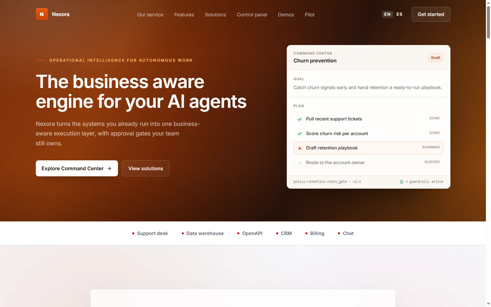

# Nexora — Operational Intelligence Landing

The business-aware engine for your AI agents. A bilingual product site for Nexora: a central intelligence layer, an operational knowledge graph and governance for cross-functional automation.



## Overview

Nexora is a B2B landing page for an AI automation platform. It pairs a warm charcoal-and-burnt-orange marketing surface with four product mockups (hero Command Center, Control panel, Operational workflows and a spend-approval demo) that share one console language: status bar, hairline columns, state dots and a monospace policy footer.

The layout, sections and copy intent come from the source template; this build migrates them to a typed design system, adds bilingual routing and removes the third-party material the original shipped.

## Key Features

- **One interactive demo:** A procurement spend-approval run (`#PR-2481`) checks budget, vendor risk, spend policy and contract terms in sequence, then routes the $48k decision to the CFO. It plays on mount and loops, and settles on its final state under `prefers-reduced-motion`.
- **Bilingual routing (`en` / `es`):** Typed dictionaries, `/[locale]` segments, `Accept-Language` negotiation and a `nexora.locale` cookie that keeps the visitor's choice.
- **Product-accurate mockups:** Hero Command Center, Control panel and Operational workflows share one `.kh-mock` surface (status chip, hairline columns, state icons, mono policy footer). They are hand-built in HTML/CSS, not screenshots, so they stay sharp and translatable.
- **CSS-only hero:** A warm gradient with a radial highlight and a vignette; no canvas, particle graph or scroll-driven timeline.
- **Metadata per locale:** Canonical URLs, `hreflang` with `x-default`, per-locale OpenGraph tags and a multilingual sitemap.
- **Localised 404:** A `[locale]/[...rest]` catch-all routes unknown paths into the styled not-found page.
- **Zero photography:** Every visual is CSS, inline SVG or a Lucide icon.

## Tech Stack

- **Framework:** Next.js 16.4.3 (App Router, Turbopack)
- **Library:** React 19.2.4
- **Language:** TypeScript 5.7.3 (strict)
- **Styling:** Tailwind CSS 4.3.3 with a CSS-first `@theme` palette
- **Motion:** CSS transitions plus a small React state machine for the spend-approval demo; no animation library on the marketing surface.
- **Icons:** Lucide React
- **Analytics:** `@vercel/analytics`
- **Package Manager:** pnpm 11.17

## Architecture

```
nexora-ai/
├── docs/
│   ├── provenance.md               # Compliance ledger and transformation history
│   └── screenshot.webp             # Visual preview artifact
├── src/
│   ├── app/
│   │   ├── [locale]/
│   │   │   ├── [...rest]/page.tsx  # Catch-all that renders the 404
│   │   │   ├── layout.tsx          # Locale shell, font, analytics
│   │   │   ├── not-found.tsx       # Styled 404
│   │   │   ├── opengraph-image.tsx # 1200x630 social card
│   │   │   └── page.tsx            # Composed landing route
│   │   ├── globals.css             # Tokens, shared kh-mock surface, section styles
│   │   ├── icon.svg                # Node-graph brand mark
│   │   ├── robots.ts
│   │   └── sitemap.ts
│   ├── components/
│   │   ├── site/                   # Header, hero, systems, service, solutions,
│   │   │                           # control, leverage, governance, demos, pilot, footer
│   │   ├── demos/spend-approval-demo.tsx
│   │   ├── ui/                     # Badge, button, input primitives
│   │   └── icons/channel.tsx
│   ├── config/site.ts
│   ├── i18n/                       # Locale config, dictionary loader, en/es copy
│   ├── lib/{seo,utils}.ts
│   └── proxy.ts                    # Locale detection and persistence
├── eslint.config.mjs
├── next.config.ts
├── package.json
└── tsconfig.json
```

`src/components/demos/slack-demo/` holds the retired four-scenario scene engine. It is no longer imported by any route and can be removed.

## Getting Started

### Prerequisites

- Node.js >= 20.9.0
- pnpm >= 10.0.0

### Installation

```bash
git clone https://github.com/JORDANROBERTO74/nexora-ai.git
cd nexora-ai
pnpm install
```

### Development

```bash
pnpm dev
```

Visit [http://localhost:3000](http://localhost:3000). The root redirects to `/en` or `/es` based on the request.

### Quality Checks

```bash
pnpm typecheck   # TypeScript, no emit
pnpm lint        # ESLint flat config
pnpm build       # Production build
```

## Deployment

The site is deployed on Vercel with the default Next.js preset. Import the repository, or run:

```bash
vercel deploy --prod
```

Set `NEXT_PUBLIC_SITE_URL` when serving from a custom domain; otherwise the canonical URL falls back to `https://nexora-ai-hq.vercel.app`.

## Performance & SEO

- `/en` and `/es` are statically generated; the locale redirect runs in the `src/proxy.ts` proxy.
- Apart from the header menu and locale switcher, the only interactive client component is the spend-approval demo; the rest of the page is static HTML, CSS and inline SVG, with no canvas loops or scroll-driven timelines.
- The demo clears its interval on unmount and skips the sequence entirely under `prefers-reduced-motion`.
- `sitemap.xml` and `robots.txt` follow the locale configuration; OpenGraph cards are generated from the same dictionaries as the page.
- Inter is self-hosted through `next/font` with automatic size-adjust metrics, so there is no font-driven layout shift.

## Accessibility

- Semantic landmarks and a single `h1`; each section is headed in order.
- Mobile navigation exposes `aria-expanded` / `aria-controls`, closes on `Escape`, and marks the active locale with `aria-current`.
- Every mock surface keeps its text available to screen readers; decorative glyphs and status icons are `aria-hidden`.
- The spend-approval demo reads `prefers-reduced-motion` and renders its final state instead of playing.
- Text meets WCAG AA on the dark and paper surfaces.

## Compliance & Licensing

This project was rebuilt under clean-room principles:

- No third-party trademarks, logos, stock photography or celebrity likenesses. The Slack mark, its palette and the Zendesk/Snowflake references were removed.
- All copy and the Spanish translation are original to this project.
- No photography is used at all: every visual is CSS, SVG or an icon.
- The full audit trail lives in [`docs/provenance.md`](docs/provenance.md).

## License

Proprietary, all rights reserved. See [LICENSE](LICENSE) for details.
